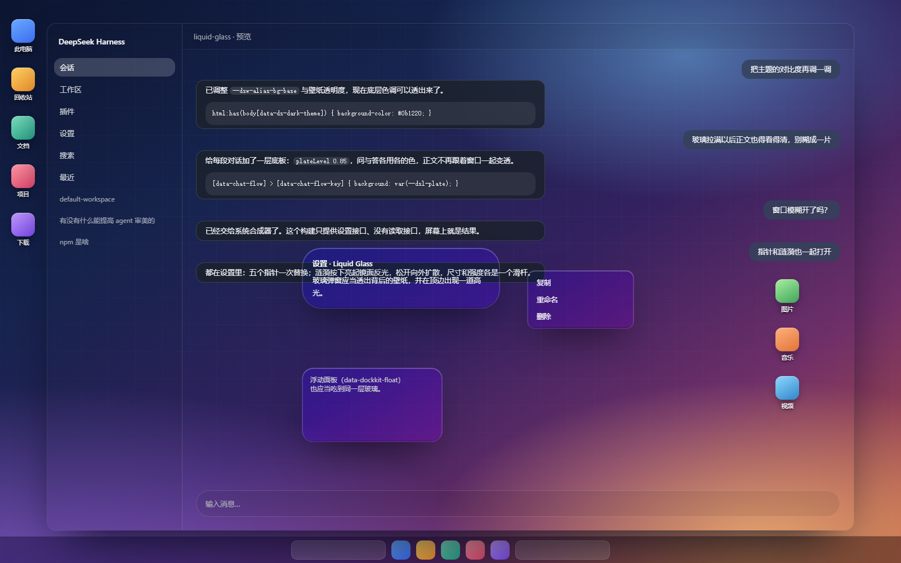
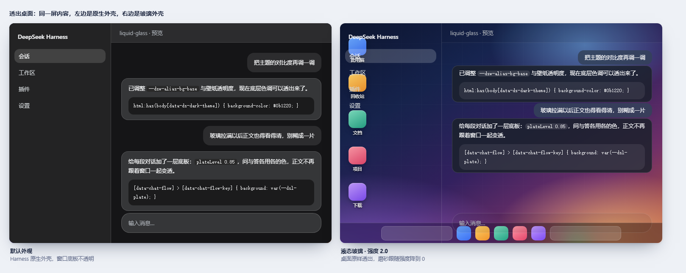
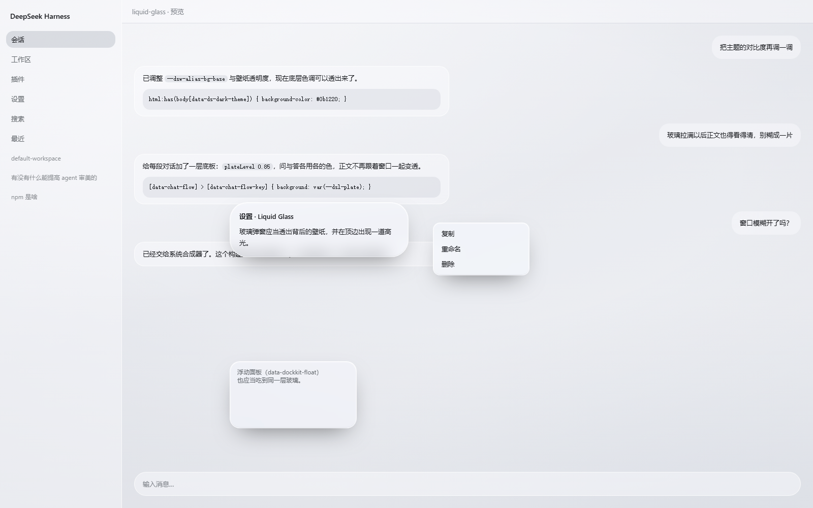
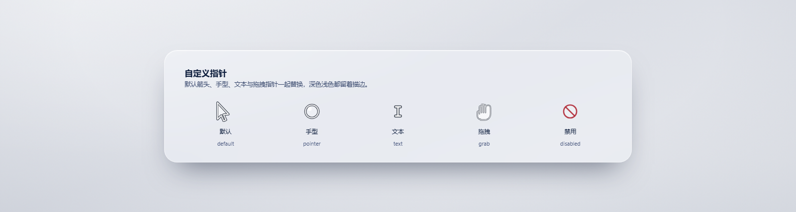
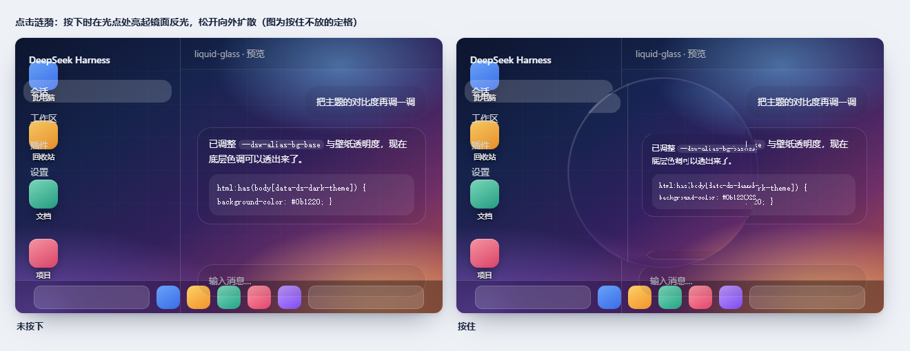
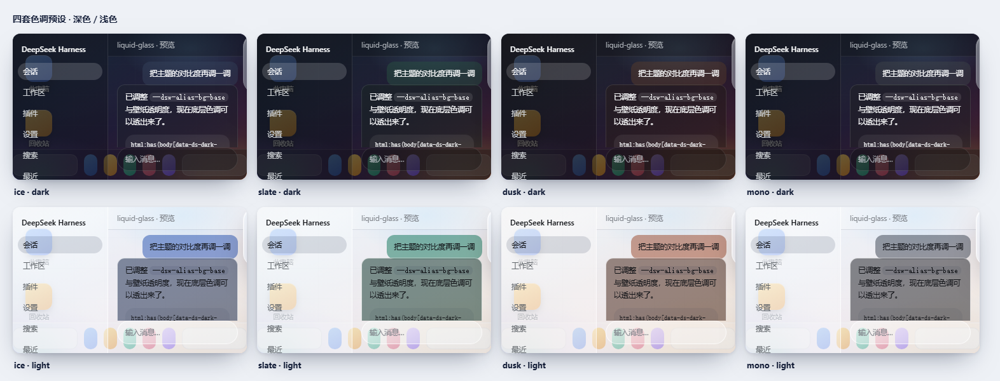

# AIR-pixel Liquid Glass

A configurable Liquid Glass theme plugin for DeepSeek Harness. It adds translucent interface surfaces, an optional wallpaper, desktop transparency, window blur, custom cursors, click ripples, and per-side conversation contrast controls.

## Screenshots

Full transparency: strength 2.0 (效果强度) with desktop transparency on (透出桌面), so the desktop reaches the eye unfiltered. The per-side conversation plates are what keep the body copy readable this far up the slider.



The same screen with and without the theme:



At the default strength, over the theme's own wallpaper — sidebar, pane, dialog, menu and floating panel:



| Custom cursors | Click ripple |
| --- | --- |
|  |  |

The four tint presets, light and dark:



These are renders, not photographs. `node tools/docshots.mjs` boots the real `client.js` in a stand-in shell over a drawn desktop. A screen capture cannot show this feature at all: `PrintWindow` drops the alpha channel, so a see-through window comes back as a black rectangle — measured in `tools/appshot.py`.

## Features

- Frosted surfaces with adjustable strength, blur, tint, and wallpaper.
- Optional transparent desktop and Windows window material controls. Desktop transparency requires the included client patch helper; the setting reports when the patch is unavailable.
- Custom cursors and click ripples, each independently configurable.
- Separate contrast settings for human and assistant messages.
- English and Chinese settings UI.

## Install

Install `air-pixel-liquid-glass` as a DeepSeek Harness bundle, then enable **Liquid Glass** in Settings. The desktop transparency and window blur controls need their host-side patch; the theme and other visual options do not.

## Development

Requires Node.js. Run the syntax and behavior checks with:

```powershell
node tools/preflight.mjs
node tools/verify.mjs
node tools/patcheck.mjs
node tools/mutationaudit.mjs
```

Regenerate the images above with `node tools/docshots.mjs` (writes `assets/`, which `screenshots.json` points the plugin market at). Some visual inspection scripts need Python with Pillow. See [DEVELOPMENT.md](DEVELOPMENT.md) for architecture, checks, and rename migration details.

## Compatibility

Designed for DeepSeek Harness on Windows and the web GUI. Desktop transparency and window blur depend on the installed Harness build and supported Windows compositor APIs.

Verified against Harness core `0.2.1-rc.2`; that is the only core this version declares support for. The slots seat moved into the core's client runner in the 0.2.x line, so `0.1.x` cores are out — stay on plugin `0.1.0` there.

## Permissions and behavior

The plugin injects theme styles and custom cursors into the Harness web UI, reads and writes its own JSON settings through a local host API, and logs diagnostic status through the host logger. The optional `tools/asarpatch.py` helper modifies the installed Harness `app.asar` only when run explicitly by the user; it keeps a backup and supports checking or reverting the patch. The plugin does not make external network requests.

## License

MIT. See [LICENSE](LICENSE).
